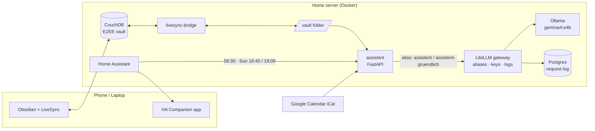

# homeserver-llm-stack

A **fully local LLM assistant** running on a 35 W home server with no GPU.
It reads my Obsidian weekly notes and Google Calendar, writes a daily briefing
at 06:30 and a weekly review on Sunday evening, suggests preparation tasks for
upcoming appointments, and delivers everything as a push notification and
dashboard through Home Assistant. No data leaves the house.

This repo is the production setup as it runs on my NixOS box, plus the
benchmarks that drove every model and engine decision.

| | |
|---|---|
| **Inference** | [Ollama](https://ollama.com) 0.40 on CPU (Intel i5-13400T), model **Gemma 4 E4B** |
| **Gateway** | [LiteLLM](https://github.com/BerriAI/litellm) as a single OpenAI-compatible endpoint with model aliases, virtual keys and a Postgres request log |
| **Benchmarking** | `llama-bench` / `llama-server` from [llama.cpp](https://github.com/ggml-org/llama.cpp), custom Ollama harness for latency, tool-calling accuracy and output quality |
| **Data access** | [livesync-bridge](https://github.com/vrtmrz/livesync-bridge) mirrors an end-to-end-encrypted Obsidian LiveSync CouchDB into a plain folder |
| **Assistant** | Python 3.13 / FastAPI service ([`assistent/`](assistent/)), 153 tests, runs as non-root with a read-only root FS |
| **Delivery** | Home Assistant `rest_command` + automations + YAML dashboard ([`homeassistant/`](homeassistant/)) |

## Architecture



## Results at a glance

Full write-up with raw data: **[BENCHMARKS.md](BENCHMARKS.md)**.

| Model (Q4_K_M, CPU) | Tool calls (10 German voice commands) | Median latency | Generation | Daily summary |
|---|---|---|---|---|
| qwen3.5:2b | 8/10 | 5.1 s | 16.9 t/s | unusable |
| qwen3:4b-instruct | 7/10 | 3.3 s | 12.7 t/s | correct, too short |
| qwen3.5:4b | 9/10 | 9.6 s | 11.4 t/s | correct, too long |
| **gemma4:e4b** | **10/10** | **3.0 s** | **19.7 t/s** | **short, correct, useful** |
| qwen3.5:9b | 10/10 | 17.0 s | 6.4 t/s | detailed, one logic error |

Things I learned along the way:

- **Gemma 4 E4B is 2× faster under Ollama than under plain llama.cpp.** The model
  ships a small MTP-style draft head (`gemma4-assistant`, 98 MB) that Ollama uses
  for speculative decoding automatically (58 % acceptance, 2.73 tokens/step).
  `llama-server -md … --spec-type draft-mtp` reproduces the same 19.5 t/s.
- **Generation is memory-bandwidth bound.** 4, 6, 10 or 12 threads give the same
  tokens/s; core pinning does nothing; the Intel iGPU via Vulkan is *slower* than the CPU.
- **Thinking pays off only for batch jobs.** The weekly review with `think: true`
  takes ~60 s instead of ~25 s, but is the only variant that gives a real
  "carry these tasks over" recommendation without inventing anything.
- **Ollama keeps computing after the client times out.** One abandoned 9 B request
  blocked the single inference slot for ~15 minutes, for *every* alias. Slow models
  are a liveness risk for the whole stack, not just for themselves.
- **In production:** daily summaries take a median of **7.6 s** end to end, weekly
  reviews with thinking ~62 s (LiteLLM request log, first days of operation).

## Design decisions

**Python computes, the LLM only phrases.** In the first benchmark every model
named a *different* "next appointment" for the same day. So everything that can be
calculated (next appointment, conflicts, free slots, overdue tasks, recurring
events, DST) is computed deterministically in Python and handed to the model as a
fact block. The model writes prose, nothing more.

**Every LLM answer is validated.** Each time in the output must appear in the fact
block, and each appointment in the fact block must appear in the output. On failure
the assistant retries once with a correction hint, then falls back to sending the
plain fact block. An LLM outage is a degraded push ("(Fakten)" in the title), never a
missing one.

**One model behind all aliases.** Clients only ever talk to LiteLLM aliases
(`assistent`, `assistent-gruendlich`, `ha-agent`). All of them point at
`gemma4:e4b` (with or without thinking), so with `OLLAMA_MAX_LOADED_MODELS=1` there
is never a model swap. The backend can be changed in [`litellm/config.yaml`](litellm/config.yaml)
without touching any client.

**Local first, cloud only by explicit choice.** `OLLAMA_NO_CLOUD=1`; a cloud alias
exists in LiteLLM but has no key, and automatic local→cloud fallback is deliberately
disabled because it would ship calendar and to-do data out of the house silently.

**Writing into a synced vault is dangerous, so writes are minimal.** The bridge syncs
both ways and propagates deletions to every device. The assistant therefore only ever
*appends* lines or flips a single `[ ]` → `[x]` byte, never truncates a file, and never
creates temp files (they would show up on every phone). The bridge was tested
against a throwaway CouchDB replica before touching the real vault
([`ops/02-vault-bridge-test.sh`](ops/02-vault-bridge-test.sh)), and the switch to
production took a cold snapshot first ([`ops/03-vault-bridge-prod.sh`](ops/03-vault-bridge-prod.sh)).

**Least privilege everywhere.**
- Everything binds to `127.0.0.1`; only the LiteLLM gateway is reachable from the
  tailnet (via `tailscale serve`, master key required). Ollama has no auth and stays local.
- The assistant has its own LiteLLM virtual key that can only use its two aliases.
- The assistant container runs as uid 1993 (the vault owner), with `read_only: true`,
  `cap_drop: ALL`, `no-new-privileges`, and only joins the LLM network, so it cannot reach CouchDB.
- The bridge gets a non-admin CouchDB user that is a member of the vault DB only;
  its secrets live in a separate `vault.env` so neither container sees the other's.
- Versions are pinned (Ollama, LiteLLM LTS, bridge commit) and excluded from
  unattended Watchtower updates where an update could break formats.

**Suggestions are not tasks.** The Sunday job proposes preparation tasks
("choose a topic before the seminar on Tuesday") in a separate section of next week's
note. Python picks candidates by keyword category and lead time and drops recurring
events; the LLM only phrases them, and its JSON answer is validated. A suggestion becomes
a task only when I move the line; deleting it is remembered so it never comes back.

## Repository layout

```
compose.yml                Ollama, LiteLLM + Postgres, livesync-bridge, assistent
litellm/config.yaml        model aliases (thinking on/off), cloud placeholder
livesync-bridge/           config generator (bridge source is cloned separately, see below)
assistent/                 the assistant: vault, calendar, planning, LLM, API, CLI + tests
bench/                     benchmark scripts and raw results
homeassistant/             rest_command, template + rest sensors, automations, scripts, dashboard
ops/                       guarded setup scripts (tailscale serve, bridge test/prod switch)
BENCHMARKS.md              all measurements and the decisions derived from them
```

The assistant, prompts, API responses and code comments are in **German**: it is
a German-language personal assistant. This README and the benchmarks are in English.

## Running it

Prerequisites: Docker with Compose, ~8 GB free RAM for the model, and for the full
setup an existing Obsidian LiveSync CouchDB and Home Assistant.

```bash
cp .env.example .env                       # LiteLLM master/salt key, DB password
cp vault.env.example vault.env             # CouchDB user + E2EE passphrase (chmod 600)
cp assistent/.env.example assistent/.env   # LiteLLM virtual key, iCal URL(s), API token

# livesync-bridge has no published image; build it from a pinned commit
git clone https://github.com/vrtmrz/livesync-bridge livesync-bridge/src
git -C livesync-bridge/src checkout 1c25230

docker compose up -d ollama litellm litellm-db
docker exec ollama ollama pull gemma4:e4b
docker compose up -d --build                # bridge + assistant
curl -s -H "Authorization: Bearer $ASSISTENT_API_TOKEN" \
     http://127.0.0.1:8100/zusammenfassung/tag | jq
```

Paths (`/mnt/data/llm/...`), the external `obsidian-network` and the fixed subnet
are specific to my server; adjust them in `compose.yml`.

Tests and CLI for the assistant (no network, no LLM needed for the tests):

```bash
cd assistent
uv sync && uv run pytest -q
uv run assistent tag --dry-run      # fact block + LLM text + duration/tokens
```

Benchmarks (needs a running Ollama with the models pulled):

```bash
python3 bench/ollama_bench.py gemma4:e4b qwen3.5:4b
bash bench/llama_bench.sh
```

## Status

| Phase | | |
|---|---|---|
| 1 | Benchmarks: models, engines, threads, iGPU | done |
| 2 | LiteLLM gateway, aliases, virtual keys, request log | live |
| 3 | E2EE vault as a folder via livesync-bridge | live |
| 4 | Assistant core: planning, prompts, validators, 153 tests | done |
| 5 | Delivery via Home Assistant (push + dashboard) | live |
| – | Calendar-based task suggestions, weekly review with thinking | live |
| 6 | Voice task entry through HA Assist (`ha-agent` alias, `/tasks` API) | API ready, voice pipeline open |

Open: quality evaluation on more real weeks, true memory footprint per engine,
`gemma4:e2b` as a lighter voice model.

## Built with

Planned, benchmarked and implemented together with **Claude Code** as a pair
programmer and sysadmin assistant, running on the server itself.

## License

[MIT](LICENSE)
